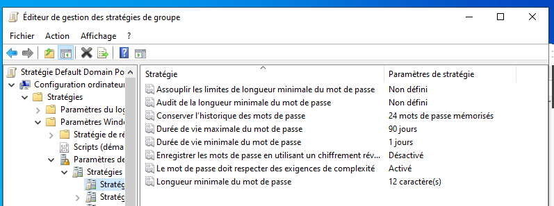
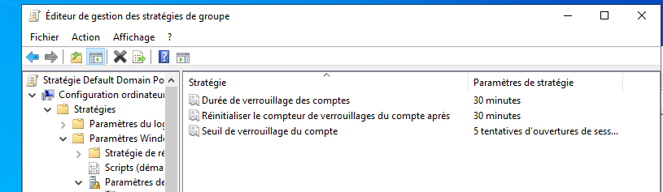
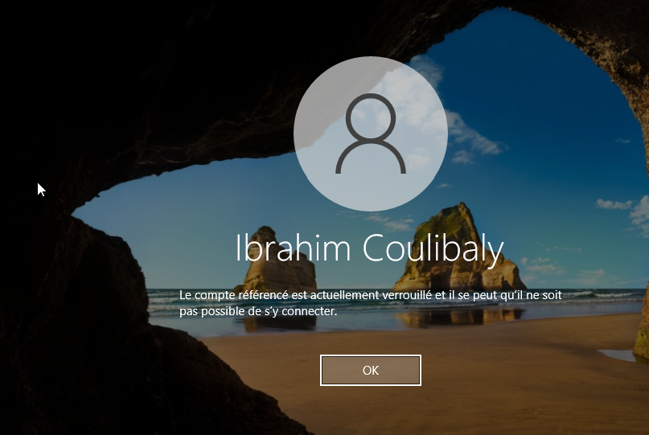
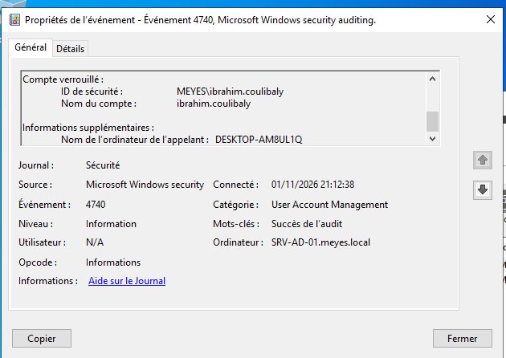

# Étape 3 : GPO de sécurité (mots de passe et verrouillage de compte)

## Objectif
Imposer à tous les utilisateurs du domaine `meyes.local` une politique de mots de passe robuste et un verrouillage automatique des comptes après plusieurs échecs de connexion, pour limiter les attaques par force brute.

## Environnement
- Serveur : `SRV-AD-01` (Windows Server 2022), contrôleur du domaine `meyes.local`
- Client : poste Windows 10 joint au domaine
- Outil : console **Gestion de stratégie de groupe**, politique **Default Domain Policy**

Ces paramètres de comptes se définissent dans la Default Domain Policy, car dans un domaine Active Directory la politique de mot de passe et de verrouillage s'applique à l'ensemble du domaine.

## Configuration
Chemin : Configuration ordinateur, Stratégies, Paramètres Windows, Paramètres de sécurité, Stratégies de comptes.

### Stratégie de mot de passe
| Paramètre | Valeur |
|---|---|
| Longueur minimale du mot de passe | 12 caractères |
| Exigences de complexité | Activé |
| Durée de vie maximale | 90 jours |

La capture montre aussi l'historique des mots de passe (24 mémorisés) et la durée de vie minimale (1 jour) : ce sont les valeurs par défaut de Windows, que je n'ai pas modifiées.

### Stratégie de verrouillage du compte
| Paramètre | Valeur |
|---|---|
| Seuil de verrouillage | 5 tentatives d'ouverture de session |
| Durée de verrouillage | 30 minutes |
| Réinitialiser le compteur après | 30 minutes |

## Test
Après plusieurs mots de passe incorrects successifs sur le poste client, le compte `ibrahim.coulibaly` est verrouillé : Windows refuse la connexion avec le message « Le compte référencé est actuellement verrouillé et il se peut qu'il ne soit pas possible de s'y connecter. »

## Retrouver le verrouillage dans les journaux
Le verrouillage du compte `ibrahim.coulibaly` est enregistré dans le journal **Sécurité** du contrôleur de domaine `SRV-AD-01`, sous l'événement **4740** (« Un compte d'utilisateur a été verrouillé »).

- Compte verrouillé : `MEYES\ibrahim.coulibaly`
- Ordinateur appelant : `DESKTOP-AM8UL1Q` (le poste client)
- Date et heure : 01/11/2026 à 21:12:38
- Enregistré par : `SRV-AD-01.meyes.local`

Pour retrouver cet événement parmi les quelque 30 000 du journal, j'ai filtré sur son numéro avec « Filtrer le journal actuel » dans l'Observateur d'événements.

Ce que j'ai observé en plus :
- Les événements 4625 (échec d'ouverture de session) présents sur le contrôleur correspondent à des tentatives de connexion sur le serveur lui-même.
- Je n'ai trouvé aucun événement 4771 dans le journal, ni de 4776 daté juste avant ce verrouillage. Je n'ai pas encore vérifié si cela dépend de la configuration de l'audit.

## Compétences mises en pratique
Gestion de stratégie de groupe, Default Domain Policy, politique de mot de passe, verrouillage de compte, test depuis un client du domaine.
