# Étape 4 : dossier partagé avec permissions par service

## Objectif
Mettre en place un dossier partagé sur le serveur où chaque service ne peut accéder qu'à son propre sous-dossier (principe du moindre privilège).

## Environnement
- Serveur : `SRV-AD-01` (Windows Server 2022), contrôleur du domaine `meyes.local`
- Client : `CLIENT-WINDOWS10`, joint au domaine
- Hyperviseur : VirtualBox

## Démarche

### 1. Groupes de sécurité (un par OU)
Création de quatre groupes **globaux de sécurité**, chacun dans son OU, avec l'utilisateur de test du service :

| Groupe | OU | Membre |
|---|---|---|
| `GG-COMPTABILITE` | COMPTABILITE | ibrahim.coulibaly |
| `GG-LOGISTIQUE` | LOGISTIQUE | gaoussou.coulibaly |
| `GG-DIRECTION` | DIRECTION | rokia.coulibaly |
| `GG-INFORMATIQUE` | INFORMATIQUE | mamadou.coulibaly |

Les droits sont donnés aux groupes et non aux utilisateurs : un nouvel arrivant est simplement ajouté au groupe de son service.

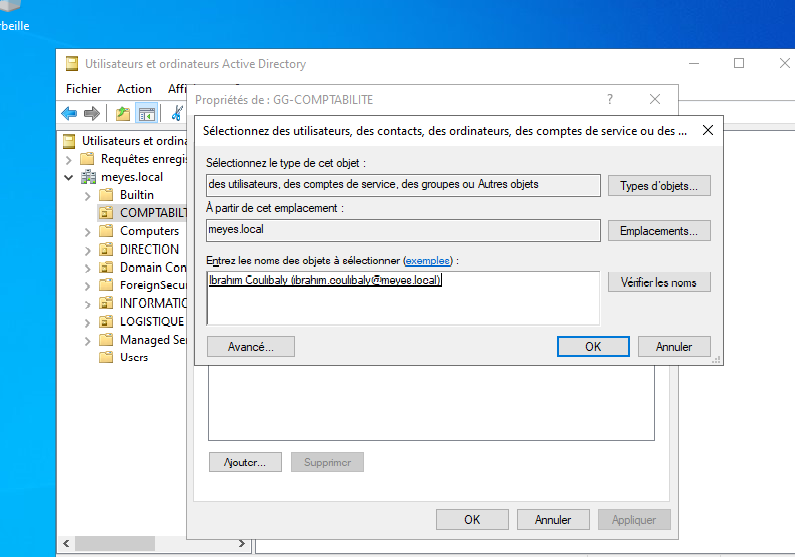
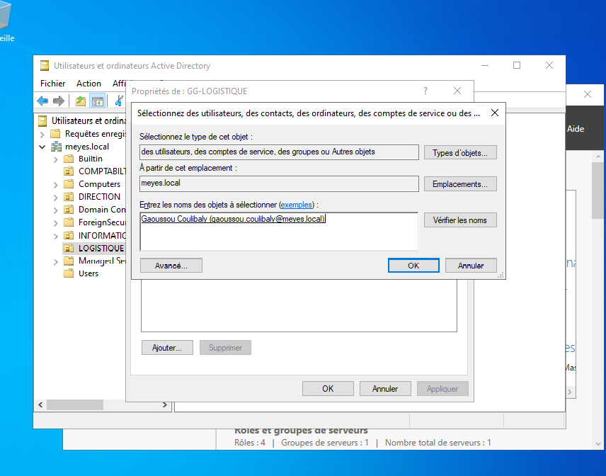
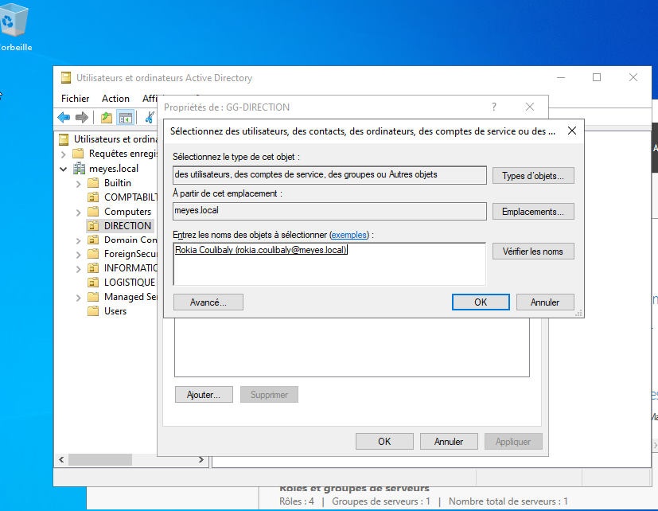

### 2. Dossier et partage
- Dossier `C:\partage` avec quatre sous-dossiers : `COMPTABILITE`, `LOGISTIQUE`, `DIRECTION`, `INFORMATIQUE`
- Partage réseau : `\\SRV-AD-01\partage`
- Permissions de **partage** laissées larges (Tout le monde, Modifier) : le contrôle fin se fait avec NTFS. Quand les deux existent, la plus restrictive s'applique.

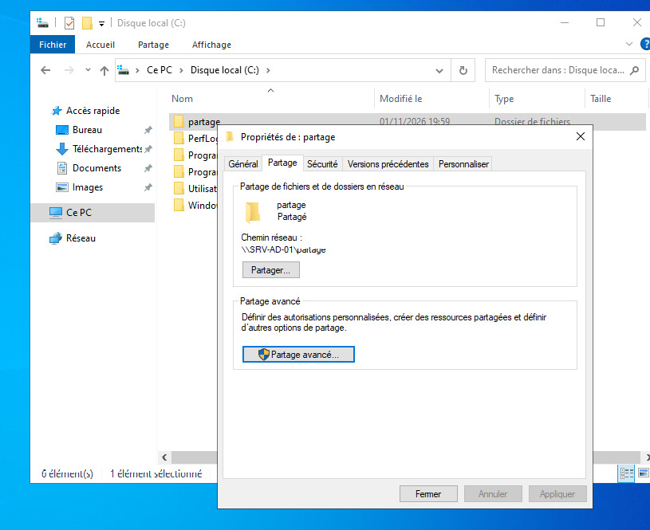

### 3. Permissions NTFS par sous-dossier
Pour chaque sous-dossier :
1. Désactiver l'héritage en convertissant les autorisations héritées en autorisations explicites
2. Supprimer le groupe `Utilisateurs`
3. Ajouter le groupe du service avec le droit **Modification** (sans Contrôle total)
4. Conserver `Système`, `Administrateurs` et `CREATEUR PROPRIETAIRE`

Le dossier parent `C:\partage` reste lisible par tous, pour que chacun puisse le traverser et atteindre son sous-dossier.

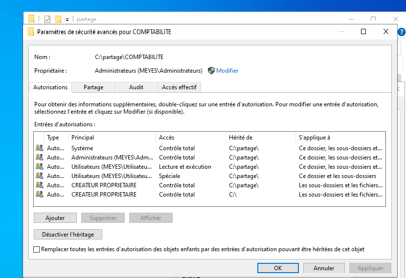
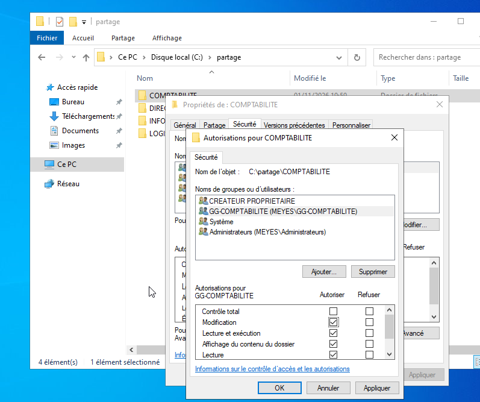
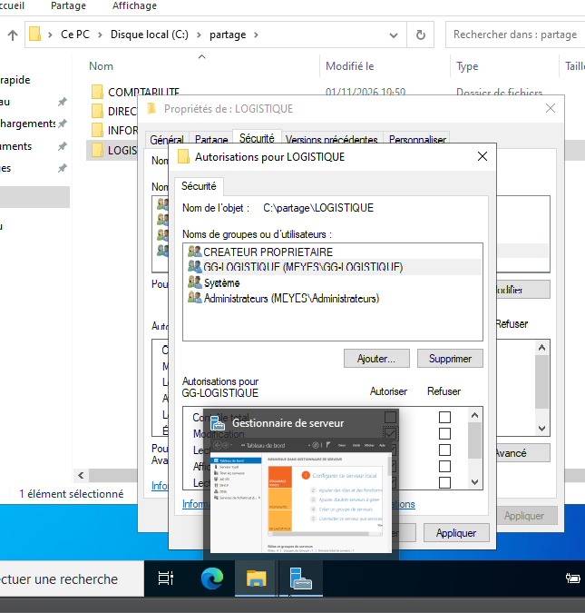
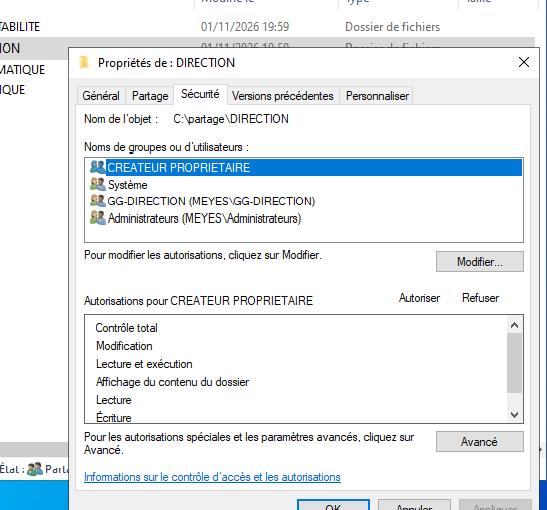
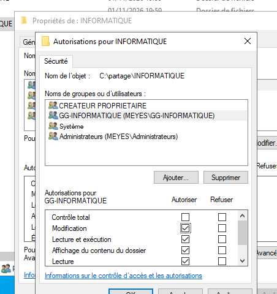

## Tests depuis le client
Chaque utilisateur ouvre `\\SRV-AD-01\partage` : il voit les quatre noms de dossiers, ouvre le sien (avec création d'un fichier) et est refusé sur les autres.

| Utilisateur | Accès autorisé | Accès refusé |
|---|---|---|
| ibrahim.coulibaly | COMPTABILITE (fichier créé) | LOGISTIQUE |
| gaoussou.coulibaly | LOGISTIQUE (fichier créé) | COMPTABILITE, DIRECTION |
| rokia.coulibaly | DIRECTION (fichier créé) | COMPTABILITE, LOGISTIQUE, INFORMATIQUE |
| mamadou.coulibaly | INFORMATIQUE (fichier créé) | LOGISTIQUE |

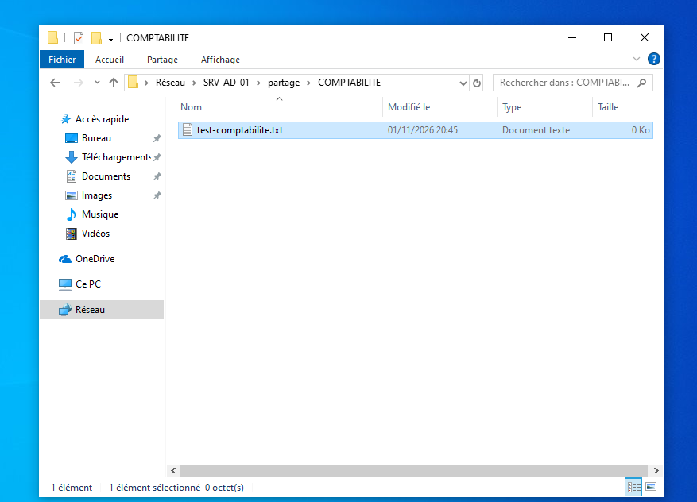
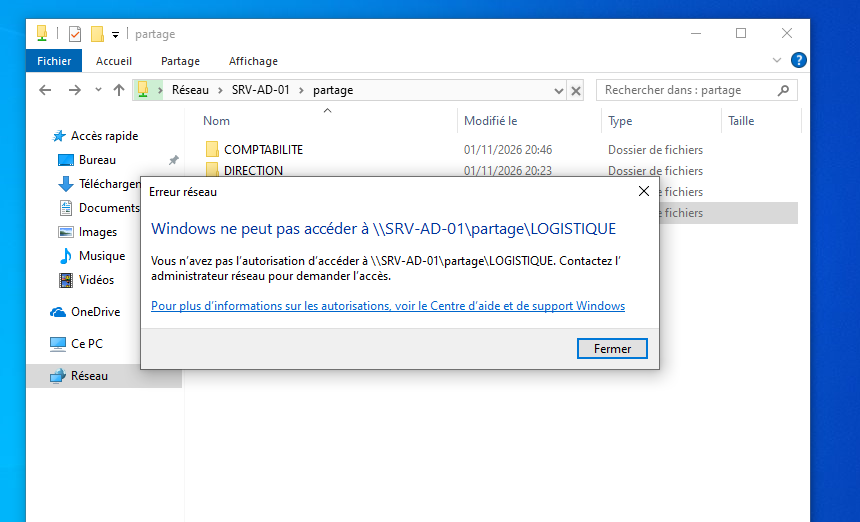
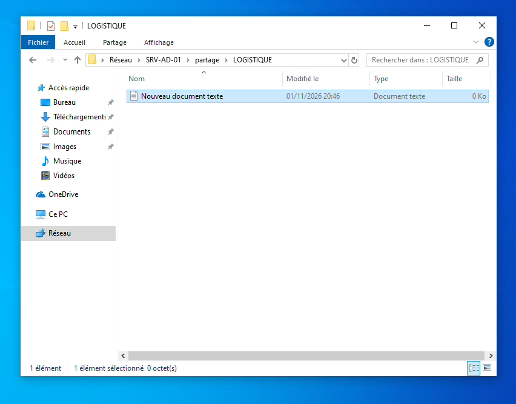
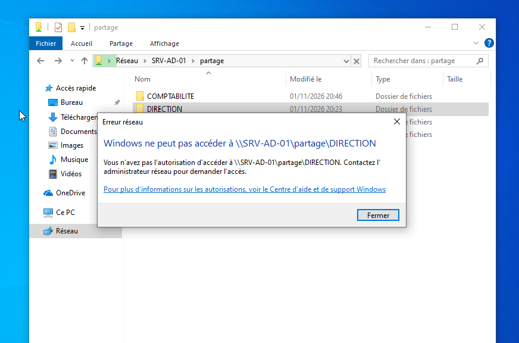
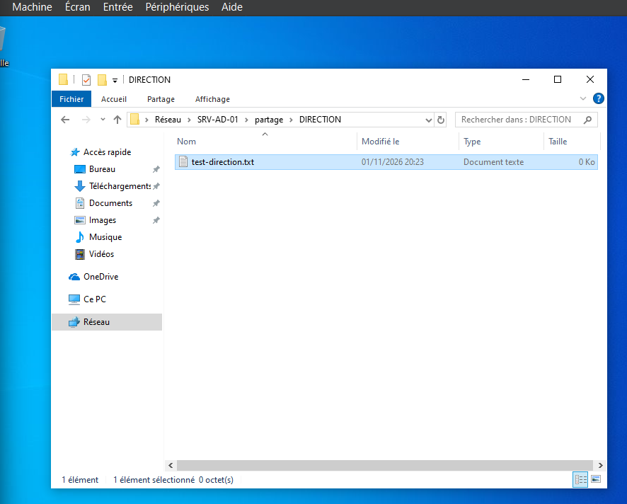
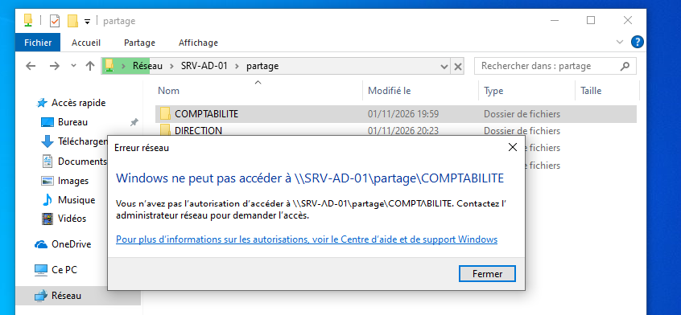
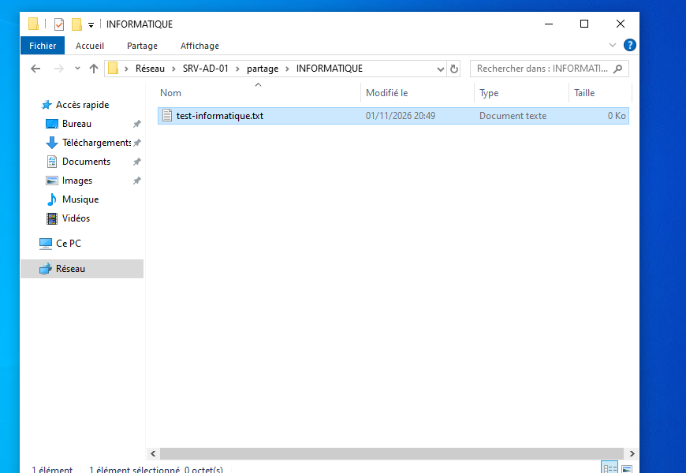
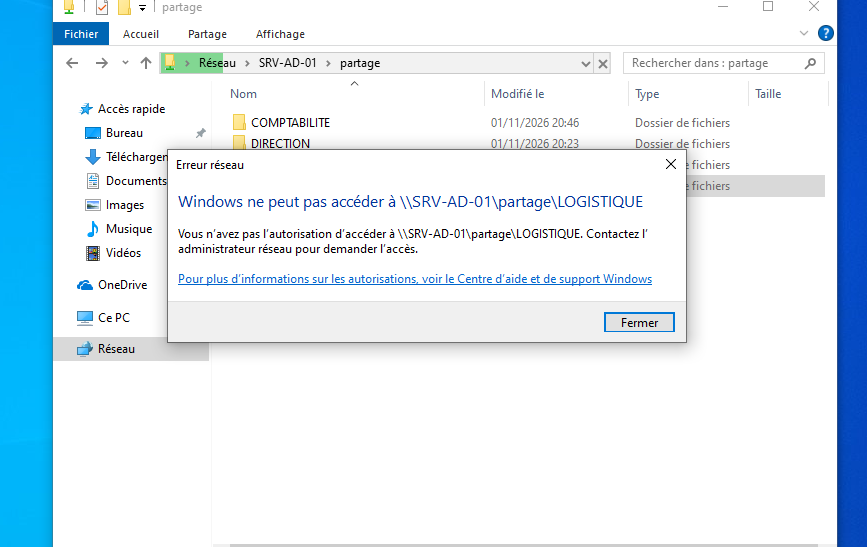

## Problème rencontré : coupures du partage et horloge décalée
Pendant les tests, le client a perdu l'accès au partage de façon intermittente (« Élément introuvable », puis « Windows ne peut pas accéder à \\SRV-AD-01\partage »). L'horloge du client était en retard par rapport au serveur, et `w32tm /resync` échouait (« aucune donnée de temps »).

- Le service de temps du serveur tournait, mais sa source était `Local CMOS Clock` (horloge de la VM, sans source externe dans le lab)
- Résolution : réglage manuel de l'heure du client pour l'aligner sur le serveur
- Après ce réglage, les tests se sont déroulés sans coupure
- À retenir : dans un domaine Active Directory, un écart de plus de 5 minutes entre deux machines peut gêner l'authentification (Kerberos)

## Compétences mises en pratique
Groupes de sécurité AD, partage SMB, permissions NTFS, héritage, moindre privilège, tests d'accès depuis un client, diagnostic d'un problème de synchronisation horaire.
