# Étape 5 : deuxième contrôleur de domaine et réplication

## Objectif
Ajouter un deuxième contrôleur de domaine (`SRV-AD-02`) au domaine `meyes.local`, pour que l'annuaire existe sur deux serveurs et se réplique entre eux, au lieu de dépendre d'un seul serveur.

## Environnement
- Premier contrôleur : `SRV-AD-01` (Windows Server 2022), IP fixe `192.168.10.100`
- Deuxième contrôleur : `SRV-AD-02` (Windows Server 2022), IP fixe `192.168.10.101`
- Réseau interne VirtualBox (`intnet`), les machines sont isolées sur le même segment
- Hyperviseur : VirtualBox

## Démarche
1. Création d'une VM neuve `SRV-AD-02` (2 Go de mémoire, 2 processeurs, disque de 50 Go) et installation de Windows Server 2022 avec interface graphique, de la même version que le premier serveur
2. Adresse IP fixe `192.168.10.101`, masque `255.255.255.0`, serveur DNS préféré : `192.168.10.100` (le premier contrôleur), sans passerelle
3. Vérification que le domaine est trouvé : `nslookup meyes.local 192.168.10.100`
4. Renommage de la machine en `SRV-AD-02` et jonction au domaine `meyes.local`
5. Installation du rôle **Services AD DS**
6. Promotion en contrôleur de domaine : « Ajouter un contrôleur de domaine à un domaine existant », avec serveur DNS et catalogue global, réplication depuis `SRV-AD-01`
7. Redémarrage automatique, puis ouverture de session avec un compte du domaine

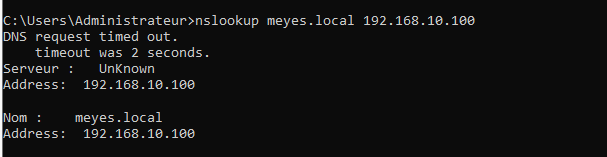

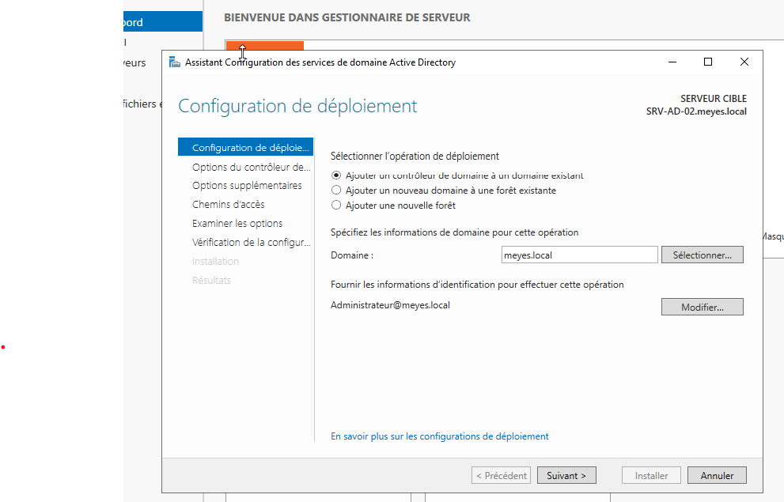

La vérification de la configuration requise s'est terminée sans erreur. L'avertissement sur la délégation DNS est attendu dans un domaine en `.local` (pas de zone parente) et n'appelle aucune action.

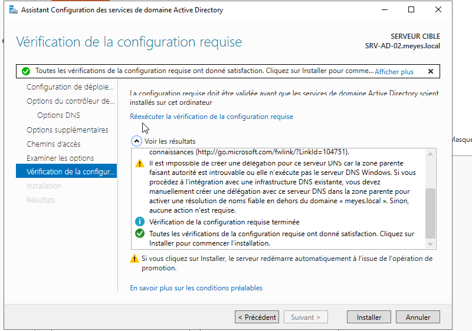

## Vérifications

### L'annuaire a été copié
Sur `SRV-AD-02`, les OU COMPTABILITE, DIRECTION, INFORMATIQUE et LOGISTIQUE sont présentes alors qu'elles n'ont été créées que sur `SRV-AD-01` : l'annuaire a été répliqué.

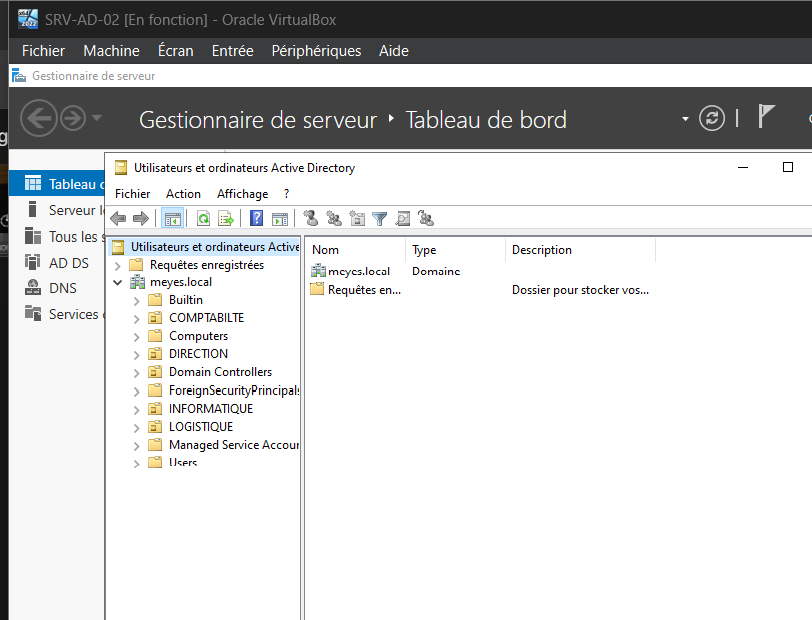

### Les deux contrôleurs sont déclarés
L'OU **Domain Controllers** contient `SRV-AD-01` et `SRV-AD-02`, tous deux catalogues globaux, dans le même site.

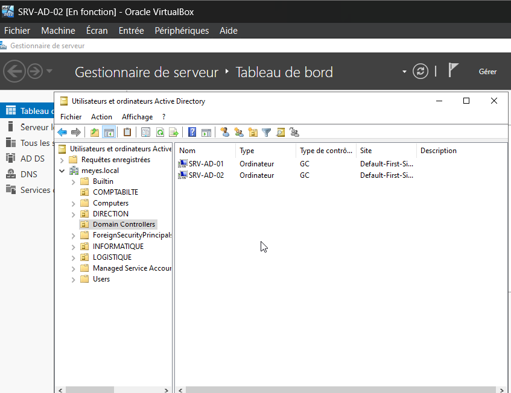

### État de la réplication
`repadmin /replsummary` n'indique aucun échec dans les deux sens (0 sur 5 pour chaque contrôleur).

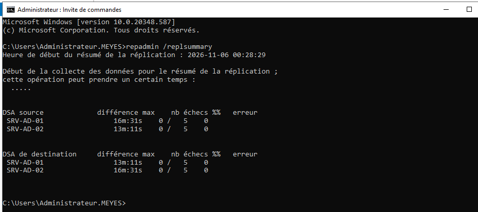

### Test dans les deux sens
- Un utilisateur `Test Replication` créé sur `SRV-AD-01` apparaît sur `SRV-AD-02`
- Un utilisateur `Test Retour` créé sur `SRV-AD-02` apparaît sur `SRV-AD-01`

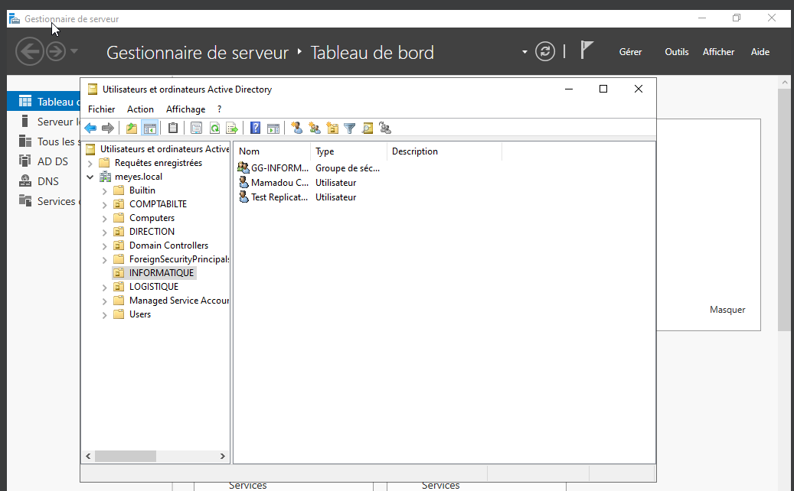

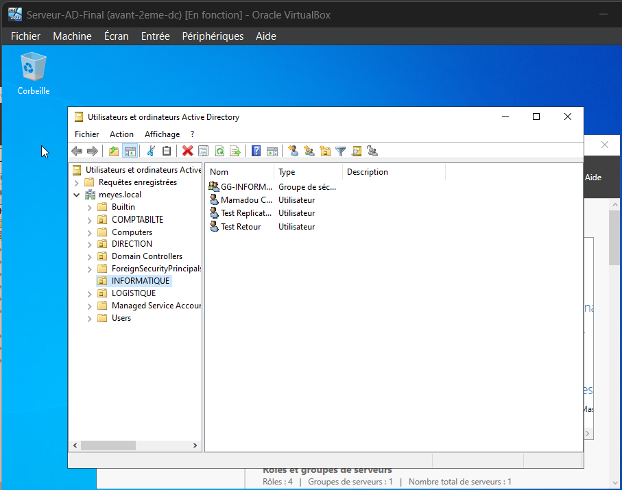

## Problèmes rencontrés
- **Identifiants refusés dans l'assistant de promotion** : l'assistant utilisait le compte administrateur local de la machine. Il faut un compte du domaine : `Administrateur@meyes.local`. Une première saisie avec une barre oblique normale (`MEYES/Administrateur`) donnait aussi un nom de compte invalide.
- **Machine très lente après la promotion** : avec 2 Go de mémoire, un contrôleur de domaine fraîchement promu est lent pendant plusieurs minutes. J'ai attendu au lieu de forcer l'arrêt, ce qui aurait pu abîmer l'annuaire.

## Test de tolérance de panne
Pour vérifier que le deuxième contrôleur peut prendre le relais, j'ai éteint `SRV-AD-01`, puis ouvert sur le client une session avec `test.retour`, un compte créé sur `SRV-AD-02` et jamais utilisé sur ce poste (Windows ne pouvait donc pas utiliser d'identifiants gardés en mémoire).

État des machines : `SRV-AD-01` éteint, `SRV-AD-02` et le client allumés.

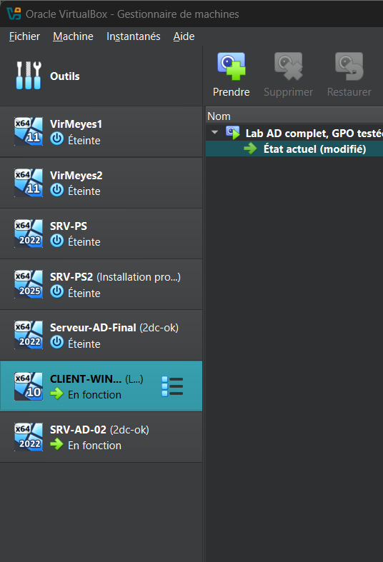

Résultats sur le client :
- `whoami` : `meyes\test.retour`
- `echo %logonserver%` : `\\SRV-AD-02`
- `nltest /dsgetdc:meyes.local` : contrôleur de domaine `\\SRV-AD-02.meyes.local` (192.168.10.101)

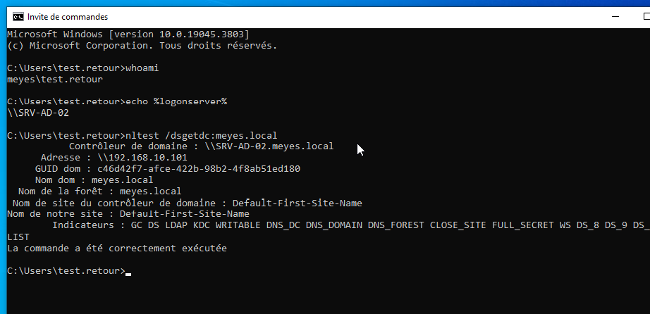

Pendant ce test, le client avait une adresse fixe (`192.168.10.120`) et `SRV-AD-02` comme serveur DNS, configurés à la main (voir ci-dessous).

### Première tentative échouée
La première ouverture de session de `test.retour` a été refusée (« votre domaine n'est pas disponible »). Démarche de diagnostic :
- `nslookup` vers `192.168.10.101` depuis le client : aucune réponse
- Sur `SRV-AD-02` : adresse IP correcte, service DNS en fonctionnement, et `nslookup meyes.local 127.0.0.1` répond avec les deux contrôleurs : le problème n'était pas sur ce serveur
- Sur le client : `Test-NetConnection` échoue sur les ports 53 et 389, et `ipconfig /all` montre une adresse `169.254.254.103` : le client n'avait plus d'adresse du réseau

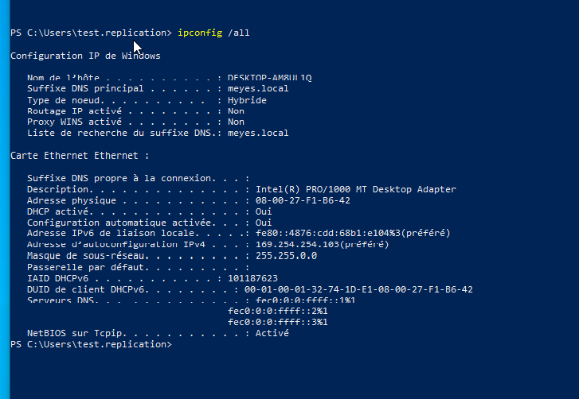

Cause probable : le DHCP du lab tourne uniquement sur `SRV-AD-01`, éteint pendant le test, et le client a perdu sa configuration réseau. Correction : adresse fixe et DNS configurés à la main, puis test réussi. Après le test, le client a été remis en DHCP.

### Ce que le test montre
- L'authentification continue quand `SRV-AD-01` est éteint : `SRV-AD-02` répond.
- Le DHCP n'est installé que sur `SRV-AD-01`, et le dossier partagé n'a été créé que sur `SRV-AD-01` : ils ne suivent pas en cas de panne.
- Suite prévue : transférer les rôles FSMO, mettre le DHCP en basculement entre les deux serveurs, et rendre le dossier partagé disponible sur les deux.

## Compétences mises en pratique
Installation du rôle AD DS, promotion d'un contrôleur de domaine supplémentaire, DNS intégré à l'annuaire, catalogue global, réplication Active Directory, vérification avec `repadmin`, test de tolérance de panne, diagnostic réseau (`nslookup`, `Test-NetConnection`, `nltest`), diagnostic d'erreurs d'authentification.
