# Étape 6 : rôles FSMO et DHCP en basculement

## Objectif
Faire en sorte que `SRV-AD-02` puisse assurer des services qui ne reposaient que sur `SRV-AD-01` : les rôles spéciaux de l'annuaire (FSMO) et la distribution d'adresses (DHCP).

## Environnement
- `SRV-AD-01` (Windows Server 2022), IP fixe `192.168.10.100`
- `SRV-AD-02` (Windows Server 2022), IP fixe `192.168.10.101`
- Client : `CLIENT-WINDOWS10`
- Réseau interne VirtualBox, domaine `meyes.local`

## Partie 1 : les rôles FSMO

### Contexte
Dans un domaine Active Directory, cinq tâches ne peuvent être tenues que par un seul contrôleur à la fois : maître de schéma, maître d'attribution de noms de domaine, émulateur PDC, maître RID et maître d'infrastructure. Par défaut, le premier contrôleur du domaine les porte toutes.

### Vérification de départ
`netdom query fsmo` sur `SRV-AD-01` : les cinq rôles sont sur `SRV-AD-01`.

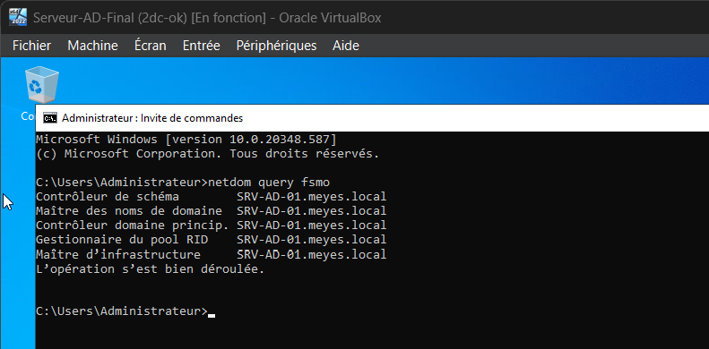

### Vérification de la réplication
Avant de transférer, `repadmin /replsummary` : 0 échec sur 5 pour les deux serveurs, dans les deux sens.

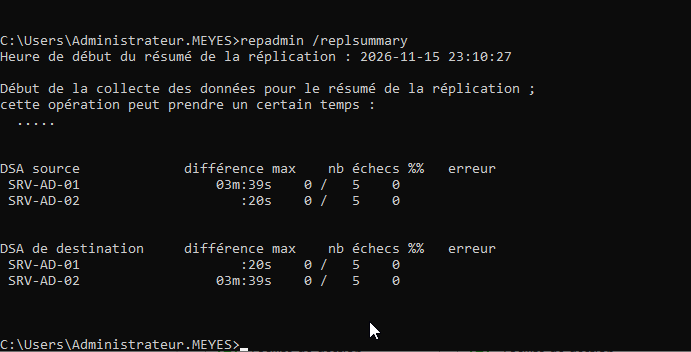

### Transfert
Depuis `SRV-AD-02`, en PowerShell, avec `Move-ADDirectoryServerOperationMasterRole SRV-AD-02 0,1,2,3,4`. J'ai fait un transfert (les deux serveurs étaient allumés), pas une prise de force, qui ne sert que si l'ancien serveur est définitivement perdu.

### Résultat
`netdom query fsmo` : les cinq rôles sont maintenant sur `SRV-AD-02.meyes.local`.

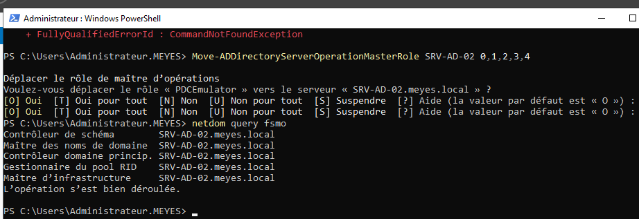

## Partie 2 : DHCP en basculement

### Contexte
Lors du test de panne de l'étape 5, le client avait perdu son adresse IP parce que le DHCP ne tournait que sur `SRV-AD-01`. Le but est qu'un deuxième serveur puisse répondre.

### Installation et autorisation sur SRV-AD-02
- Installation du rôle **Serveur DHCP** sur `SRV-AD-02`
- Assistant post-installation : création des groupes de sécurité DHCP et autorisation du serveur dans l'annuaire (« Terminé » pour les deux)

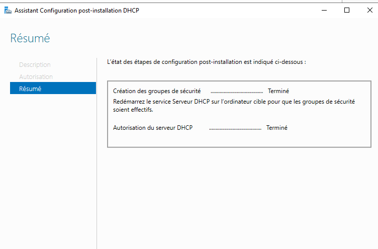

Je n'ai pas créé d'étendue à la main sur `SRV-AD-02` : elle est copiée par le basculement, ce qui évite deux étendues qui se chevauchent.

### Configuration du basculement
Depuis la console DHCP de `SRV-AD-01` : clic droit sur l'étendue, puis « Configurer un basculement ».
- Partenaire : `SRV-AD-02`
- Mode : équilibrage de charge, 50 % / 50 %
- Délai de transition maximal du client : 1 heure
- Authentification du message activée, avec un secret partagé

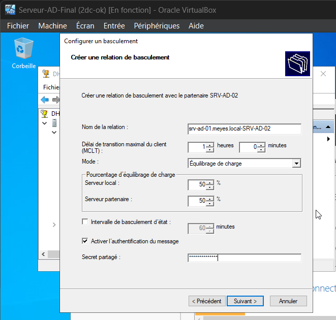

Toutes les étapes de l'assistant sont affichées en « Réussi ».

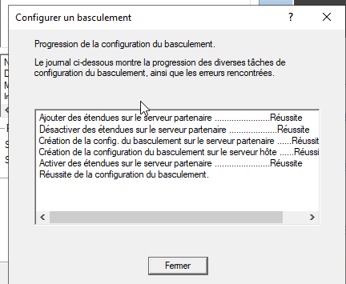

### Vérifications sur SRV-AD-02
L'étendue `Etendue-Meyes` (`192.168.10.150` à `192.168.10.200`) est apparue sur `SRV-AD-02` sans que je la crée, et l'onglet « Basculement » indique l'état « Normale » pour les deux serveurs.

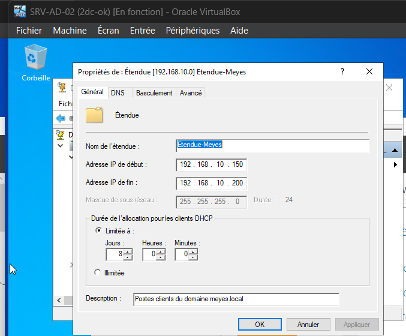

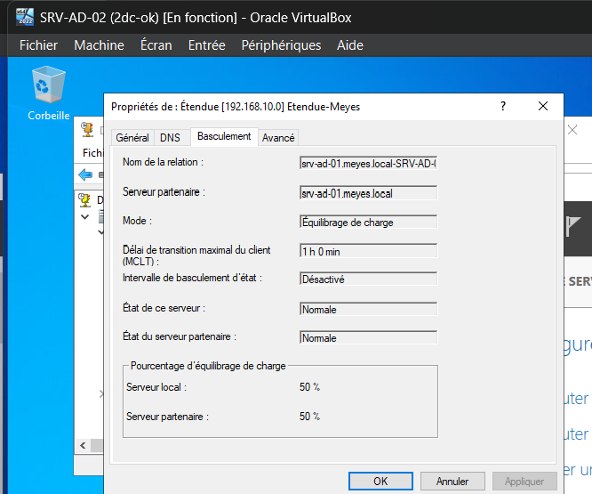

Les options d'étendue ont aussi été copiées : l'option 006 (serveurs DNS) contient `192.168.10.100` et `192.168.10.101`.

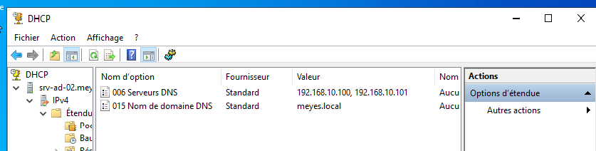

## Test
`SRV-AD-01` éteint, `SRV-AD-02` et le client allumés :

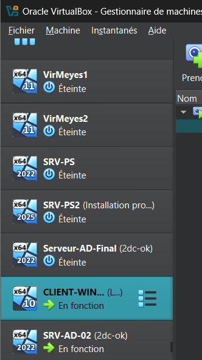

Sur le client, `ipconfig /release` puis `ipconfig /renew` : le serveur DHCP indiqué est `192.168.10.101` (`SRV-AD-02`), avec une adresse en `192.168.10.176` et les deux DNS.

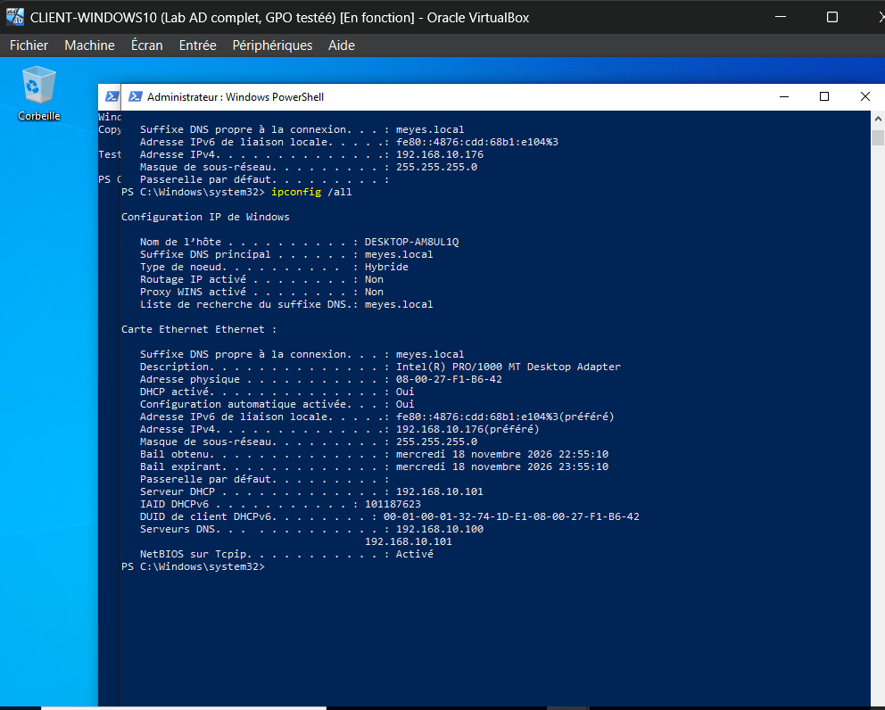

### Remarques
- L'adresse du client a changé (`192.168.10.176` au lieu de `192.168.10.150`) : avec l'équilibrage de charge, chaque serveur donne des adresses de sa part du pool.
- Le bail obtenu dure 1 heure, alors que le bail configuré dans l'étendue est de 8 jours. Je n'ai pas vérifié la cause.

## Ce qui reste
Le dossier partagé `\\SRV-AD-01\partage` n'existe que sur `SRV-AD-01` : il n'est pas disponible si ce serveur est éteint. Piste : DFS pour le rendre accessible depuis les deux serveurs.

## Compétences mises en pratique
Rôles FSMO (consultation et transfert), réplication Active Directory, installation et autorisation d'un serveur DHCP dans un domaine, basculement DHCP en équilibrage de charge, tests de panne, PowerShell.
